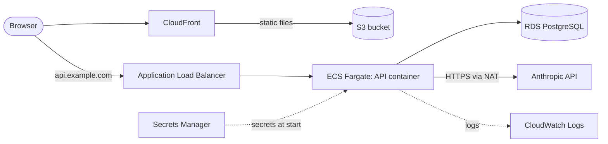

# Deploying RubricCheck on AWS

These are recommendations for taking the app to AWS. **Nothing here has been deployed or tested on AWS**:
the backend container image has been built and run locally, and everything is configured through environment
variables (12-factor), so the steps below should map directly. Check current AWS limits and prices before relying on
any number in this document.

## Read this before exposing it publicly

RubricCheck has **no user accounts and no rate limiting**. Anyone who can reach the API can start gradings, and every
grading spends your Anthropic credits (a grading is roughly `criteria x runs` model calls, plus feedback). Before
the URL is public, do at least one of:

- put the site behind authentication (for example Amazon Cognito with the load balancer, or CloudFront signed cookies);
- add AWS WAF rate-based rules on the load balancer or CloudFront;
- restrict access to a VPN or an IP allow-list;
- set a monthly spend limit and alerts in the Anthropic console.

When you add accounts, `assignments` is the place to add an `owner_id`; every other table hangs off an assignment.

## Target architecture



| Piece | Choice | Notes |
|---|---|---|
| Frontend | S3 + CloudFront | `npm run build` produces static files in `frontend/dist` |
| API | ECS Fargate behind an ALB | One container, port 8000, health check `GET /api/health` |
| Database | RDS PostgreSQL 16 | Private subnets; security group allows 5432 only from the API's security group |
| Secrets | Secrets Manager | `ANTHROPIC_API_KEY` and `DATABASE_URL` (it contains the password) |
| Logs | CloudWatch Logs | The container logs to stdout (`awslogs` driver) |

AWS App Runner is a simpler alternative to ECS + ALB for the API (it runs a container from ECR with env vars and
secrets), but check its request timeout against the grading-time note below first.

## Grading time is the main deployment constraint

Grading runs **inside the HTTP request** (the simplest thing that works for an MVP). A grading makes
`criteria x runs` model calls concurrently plus feedback calls, so it can take from tens of seconds to a few minutes.
Every hop in front of the API has a timeout that must be longer than that:

- **ALB idle timeout** defaults to 60 seconds. Raise it (for example to 300 s).
- **CloudFront origin response timeout** is short by default (30 s, with a low maximum unless you request a quota
  increase; verify the current limits). A long grading will fail through CloudFront.
- So: **serve the API from its own hostname that points straight at the ALB** (`api.example.com`), not through the
  CloudFront distribution, and build the frontend with `VITE_API_BASE_URL=https://api.example.com`. Set
  `CORS_ORIGINS` on the API to the frontend's origin.

The longer-term fix is a background job. The grading work is already isolated in one function,
`run_grading()` in `backend/app/services/grader.py`, with the grading row created first and a `status` column
(`running` / `complete` / `failed`). To move it off the request: have `POST /submissions/{id}/grade` enqueue a message
(SQS) and return the grading id immediately, run `run_grading` in a worker service, and have the results page poll
`GET /gradings/{id}`. Gradings stuck in `running` after `GRADING_STALE_MINUTES` are marked failed at startup.

## Steps

### 1. Database

Create an RDS PostgreSQL 16 instance in private subnets. Build the connection string as

```
postgresql+asyncpg://<user>:<password>@<endpoint>:5432/<database>
```

If your instance requires TLS, add `?ssl=require` (asyncpg's option). Verify this against your RDS parameter group.

### 2. Image

```bash
# Fargate runs Linux. Build for the architecture of your task definition:
# arm64 is supported (and matches an Apple Silicon laptop); otherwise use linux/amd64.
docker build --platform linux/arm64 -t rubriccheck-api backend
aws ecr create-repository --repository-name rubriccheck-api
docker tag rubriccheck-api:latest <account>.dkr.ecr.<region>.amazonaws.com/rubriccheck-api:latest
aws ecr get-login-password | docker login --username AWS --password-stdin <account>.dkr.ecr.<region>.amazonaws.com
docker push <account>.dkr.ecr.<region>.amazonaws.com/rubriccheck-api:latest
```

### 3. Task definition

- Container port `8000`; set `runtimePlatform` to match the image architecture.
- Start with 0.5 vCPU / 1 GB. The service waits on network calls rather than computing, so memory and concurrency
  matter more than CPU.
- Plain environment variables: `ANTHROPIC_MODEL`, `ANTHROPIC_EFFORT`, `GRADING_RUNS`, `GRADING_CONCURRENCY`,
  `CORS_ORIGINS`, `LOG_LEVEL`, and the limits (see the table in the README).
- Secrets (from Secrets Manager): `ANTHROPIC_API_KEY`, `DATABASE_URL`.
- Health check: `GET /api/health` returns 200 even when the database is down (it reports `"database": "unavailable"`),
  so use it for liveness. The image also has a Docker `HEALTHCHECK`.
- The task needs outbound internet access to reach the Anthropic API (a NAT gateway, or public subnets with a
  locked-down security group). The NAT gateway is often the largest fixed cost in a small deployment.

### 4. Migrations

Migrations are **not** run on startup, so a bad migration can't take down running tasks. Run them as a one-off task
before each deploy, using the same image and secrets with the command overridden:

```bash
aws ecs run-task --cluster <cluster> --task-definition rubriccheck-api \
  --launch-type FARGATE --network-configuration "<same subnets and security group>" \
  --overrides '{"containerOverrides":[{"name":"api","command":["alembic","upgrade","head"]}]}'
```

Make migrations backwards compatible with the previous release (add columns before using them) so a rolling deploy
works.

### 5. Load balancer and service

- Target group: protocol HTTP, port 8000, health check path `/api/health`.
- Listener on 443 with an ACM certificate; redirect 80 to 443.
- Raise the idle timeout (see above).
- Run at least two tasks across two availability zones once real users depend on it.

### 6. Frontend

```bash
cd frontend
VITE_API_BASE_URL=https://api.example.com npm run build
aws s3 sync dist s3://<bucket> --delete
```

Serve the bucket through CloudFront with Origin Access Control. Single-page-app routing needs custom error responses
that map 403 and 404 to `/index.html` with status 200. Invalidate the distribution after each deploy.

## Operations

- **Spend and latency:** every model call is logged to the `llm_calls` table (purpose, model, prompt version, token
  counts, latency, success). Query it for cost per grading and for failure rates.
- **Alarms worth having:** ALB 5xx rate, unhealthy targets, RDS CPU and free storage, and the share of failed `llm_calls`.
- **Backups:** enable RDS automated backups. Student drafts are personal data; decide a retention period and
  encrypt storage (RDS encryption at rest).
- **Prompt changes:** prompts are versioned files; the version is stored on every grading and LLM call, so you can
  tell which prompt produced which result after a change.

## Checklist

- [ ] Authentication, rate limiting, or network restriction in place
- [ ] Anthropic spend limit and alert set
- [ ] RDS in private subnets, automated backups on, storage encrypted
- [ ] Secrets in Secrets Manager, not in the task definition or the image
- [ ] ALB idle timeout longer than the slowest grading; API not behind a short CloudFront timeout
- [ ] `CORS_ORIGINS` set to the real frontend origin only
- [ ] Migrations run as a one-off task before deploys
- [ ] Alarms on 5xx, unhealthy targets, and failed model calls
